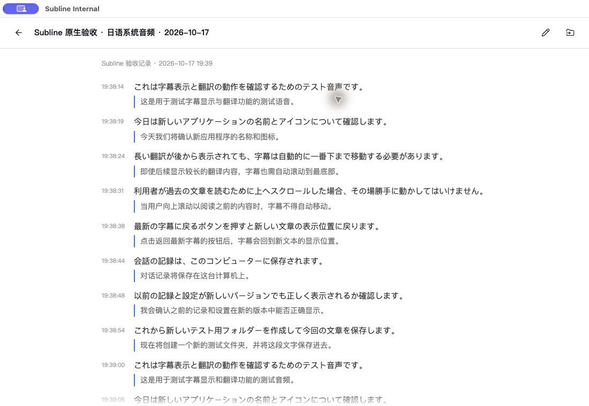
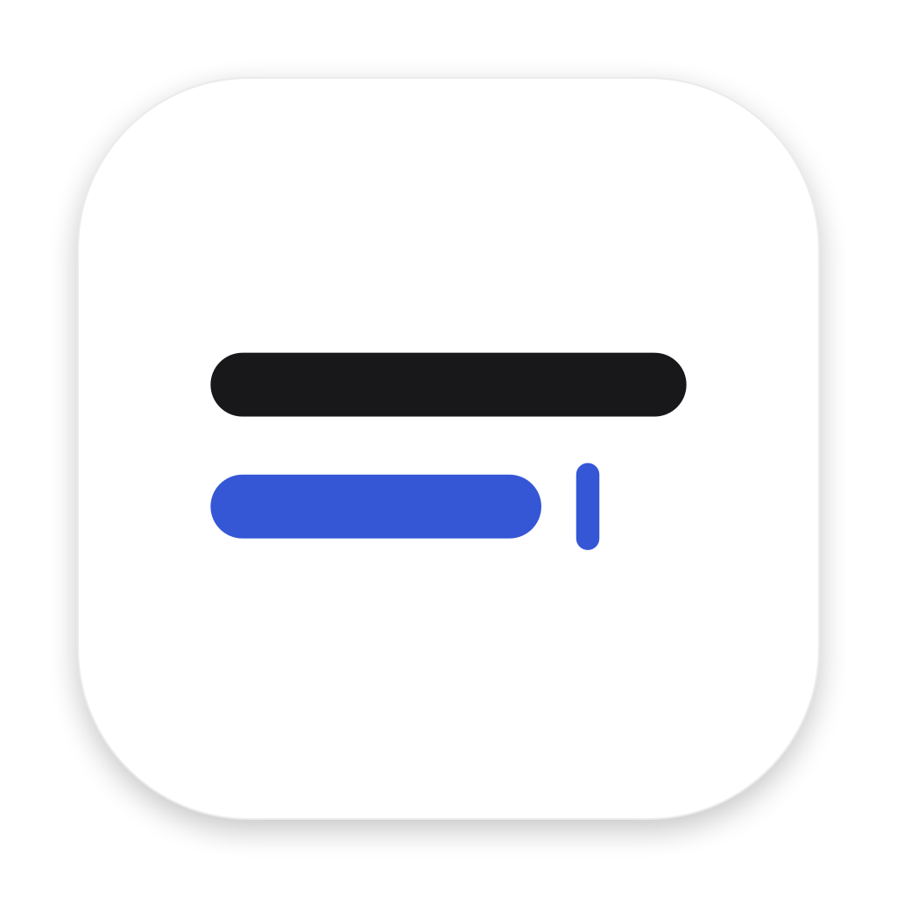
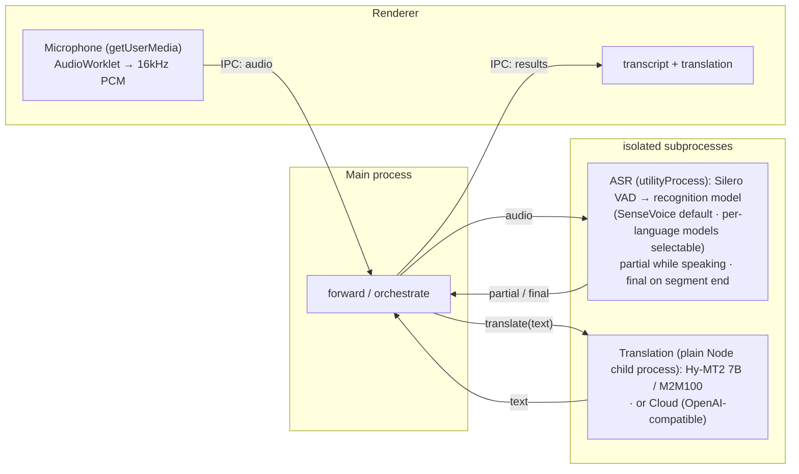

# Subline

**Subline** is a local, real-time transcription and translation app, developed as a classroom-focused derivative of [baijunjie/realtime-translator](https://github.com/baijunjie/realtime-translator), maintained by [Jack](https://github.com/sany2ng0226-boop). Upstream Git history is preserved. This repository contains our custom source; upstream release links below refer to upstream builds, not this version.

**[简体中文](README.zh-CN.md)** · [Product rules](docs/product/experience.md) · [Code map](docs/project-map.md)



*Actual macOS Internal archive view using synthetic test speech. This is a saved transcript, not a live performance benchmark.*

## Features

- Continuous caption rows: provisional text is extended, corrected and confirmed in place; translations return to the same row.
- Stable-prefix / tentative-tail styling, language-specific native Japanese and Simplified Chinese fonts, and a narrower bilingual reading layout.
- Rule-based Japanese sentence assembly before translation. Local-model sentence judging remains an offline experiment, not the default recording path.
- Built-in macOS Hy-MT2 7B Metal inference and source-only context, also supported by optional OpenAI-compatible endpoints.
- macOS translation backpressure: one active request, at most three waiting, and a 15-second waiting deadline. Overloaded or expired translations fail visibly while their transcripts remain available.
- Separate stable and Internal macOS channels with isolated settings, archives and model caches.
- Internal archive folders, content-derived editable titles, rename and move, with persistence across restarts. Saving is manual; stopping recording does not automatically archive the session.

## macOS build and distribution status

**Subline** is the new product name; **Subline Internal** is the internal macOS channel. The Subline Internal build has been installed and checked locally: real system-audio capture, Japanese transcription and Chinese translation, scrolling and archive restart persistence. Microphone start/stop has been checked; real microphone recognition, distant speech, noisy groups and sustained event/development use have not been qualified. It is an ad-hoc local build, not a Developer ID signed or Apple-notarized release. Web and iOS builds have not been validated as part of that check.

The previously distributed **Classroom Translator 0.2.0-beta.1** friends beta remains a historical release under its original name. That specific application was Developer ID signed and Apple notarized, with the ticket stapled to the `.app`; this does not cover Subline builds or separately notarize its DMG. The installation steps below apply to that historical beta. This is a public source preview; upstream downloads below are not our builds. No new Subline binary is published with this source milestone. System audio requires macOS 14.2 or newer. Other memory capacities have not been qualified; local inference has been exercised on a 48 GB development Mac.

1. Obtain this beta's `.dmg` from the maintainer, then drag **Classroom Translator.app** into Applications.
2. Open the app normally and accept the standard macOS first-open confirmation if shown; no quarantine-removal command or security-setting change is required. Choose your native language. New macOS settings enable the built-in **Hy-MT2 7B Q4_K_M** translator; existing settings are preserved.
3. Choose Japanese and SenseVoice for the classroom configuration. On first recording, confirm the required model downloads. The Hy-MT2 weights are approximately 4.62 GB and are downloaded from a pinned Tencent source with size and SHA-256 validation.
4. After the downloads finish, the app runs recognition and translation locally. **LM Studio, an API key and a separately started model server are not required.** The Metal inference runtime is included; model weights are not bundled.
5. Choose system audio on supported macOS versions and grant the requested capture permission. Transcripts and translations remain in one continuous timeline; archive a session to keep it for later.

The optional API translation backend remains available for an existing local server or a user-configured remote service. Local Hy-MT2 keeps the same source-only context, rule-based sentence assembly and translation backpressure. Changing the inference runtime does not guarantee byte-for-byte identical translations.

## Development and checks

This source milestone includes the Subline branding, continuous-caption UI, following fix and Internal archive folders. The historical Classroom Translator binary remains separate and does not contain these latest changes. The Internal home-screen recognition-language selector and archive folders are enabled by an Internal build.

Use Node.js 22 and pnpm **10.33.0**, pinned in `package.json`. For example:

```sh
git clone https://github.com/sany2ng0226-boop/subline.git
cd subline
npx pnpm@10.33.0 install --frozen-lockfile
npx pnpm@10.33.0 dev
# Build the Internal app with the archive-folder interface:
npx pnpm@10.33.0 --filter @rt/macos dist:preview
```

The default Internal output is `apps/macos/release-preview/mac-arm64/Subline Internal.app`. The build command does not install or publish the application.

Install the package manager pinned in `package.json`, run `pnpm install`, then `pnpm dev`. `pnpm dist` builds the Apple Silicon DMG in `apps/macos/release/`; signing depends on a locally available identity, and the command alone does not complete Apple notarization or publish a release. The separate Preview build remains available via `pnpm --filter @rt/macos dist:preview` with isolated data.

For a distributable build, select the local Developer ID Application identity with `CSC_NAME` using the certificate display name **without** the `Developer ID Application:` prefix. Keep its private key in Keychain. The verified local notarization route uses an Xcode archive and `xcodebuild -exportArchive` with `method=developer-id` and `destination=upload`, followed by `xcodebuild -exportNotarizedApp` after Apple accepts it. Validate the exported app with `codesign --verify --deep --strict`, `xcrun stapler validate` and `spctl --assess --type execute`; create the DMG from that app via electron-builder `--prepackaged` to preserve its attached ticket. Credentials and private keys are not repository configuration.

Check source with `pnpm check`. Caption identity and macOS queue regressions can be checked with `pnpm exec vitest run packages/ui/src/composables/useTranscription.test.ts apps/macos/src/main/translation/request-queue.test.ts`. Fixed classroom replay, including the direct local engine via `RT_LOCAL_CACHE`, is described in [macOS test documentation](apps/macos/test/README.md).

GitHub Actions runs checks on `main`; Pages deployment is disabled unless the repository variable `ENABLE_PAGES` is explicitly set to `true`.

Private classroom recordings, transcripts, user settings, credentials and downloaded model weights are not included. Archives contain finalized text and completed translations, not original recordings; pending translations are not added to an already-saved snapshot. There is no cross-device sync. The screenshot uses synthetic test content. Upstream's small web VAD asset and runtime files remain part of its original source tree. Build and test outputs are reproducible local artifacts.

## Attribution and distribution status

This is derived work, not an independently authored replacement for upstream. The upstream package metadata declares `ISC`; the checked source tree does not include a standalone license text. That metadata and all upstream history are preserved. This repository preserves that declaration and does not introduce a replacement license for upstream code. Check upstream licensing before further redistribution. Model weights and dependencies have their own terms.

Current behavior and implementation navigation: [product rules](docs/product/experience.md) and [project map](docs/project-map.md).

---

## Upstream documentation

The documentation below is retained for upstream platform and build context. **The custom-build status above and the product rules take precedence.** All upstream release and demo links below belong to upstream, not this derivative.

<p align="center">
  
</p>

# Realtime Translator

> Local, real-time speech transcription & translation for macOS, iOS, and the browser — audio and text stay on-device (cloud translation optional).

**English** · [简体中文](README.zh-CN.md) · [日本語](README.ja.md) · [한국어](README.ko.md)

Try the web version instantly, no install: **https://baijunjie.github.io/realtime-translator/**

## Platforms

All three platforms share the same core logic and UI; they differ in how they run and in a few capabilities:

|  | macOS | iOS | Web |
|---|---|---|---|
| **Get it** | Unsigned `.dmg` ([Releases](https://github.com/baijunjie/realtime-translator/releases)) | Build from source | [Open in browser](https://baijunjie.github.io/realtime-translator/) / install as PWA |
| **Recognition models** | SenseVoice + Paraformer / ReazonSpeech / Parakeet | SenseVoice | SenseVoice + Paraformer / ReazonSpeech / Parakeet |
| **Local translation** | Hy-MT2 7B (Classroom default) / M2M-100 418M / 1.2B | Apple on-device | M2M-100 418M † |
| **Cloud translation** | ✓ | ✓ | ✓ |
| **Audio source** | Microphone + system audio (14.2+) | Microphone | Microphone |
| **Runtime** | Electron · sherpa-onnx N-API | Capacitor · native C++ | Browser · single-thread WASM |
| **Storage** | app-data files | Preferences | IndexedDB + Cache |

† On iOS/iPadOS Safari, local translation is unavailable (WebKit's per-tab memory can't hold a translation model alongside ASR) — those devices use cloud translation only.

### macOS

The linked upstream releases belong to Realtime Translator. For this signed and notarized Classroom beta, use the maintainer-provided package and installation steps above; open **Classroom Translator.app** normally after copying it to Applications. The standard first-open confirmation and audio-capture permission prompts still apply.

macOS is the most capable target: it can capture **system audio** (what your Mac is playing, macOS 14.2+) as well as the microphone, and it offers the higher-quality M2M-100 1.2B translation model.

### iOS

There is no prebuilt app yet — build it from source. The native plugin must be wired into a Capacitor iOS host, which needs the Xcode toolchain and a real device (Apple's Translation framework doesn't run in the simulator). See [`apps/ios/native-plugin/INTEGRATION.md`](apps/ios/native-plugin/INTEGRATION.md). Recognition runs on-device (SenseVoice); translation uses Apple's on-device Translation framework (iOS 18+).

### Web

Runs entirely in the browser — nothing to install and no server. **Open it at [baijunjie.github.io/realtime-translator](https://baijunjie.github.io/realtime-translator/)** or install it as a PWA; after the first load it works offline (models and app shell are cached). Microphone only.

## Features

- Real-time speech recognition in Chinese / Japanese / English / Korean — auto-detected, or locked to a single language for markedly fewer misdetections on short utterances
- Live captions — partial text while you speak, finalized per segment
- **Native-language driven** — one chosen language is both the interface language and the translation target; speech in any other language is translated into it (Chinese normalized to Simplified). In auto-detect mode, speech in your own language is reverse-translated into the most recent other language
- **On-device or cloud translation** — local models run offline and text never leaves your machine; cloud is an optional OpenAI-compatible endpoint (text is sent to a third party)
- Multiple recognition and translation models, downloaded on demand (nothing is bundled into the app)
- Conversation archive — save a session and reopen it later
- Recognition runs locally; the Classroom Hy-MT2 translator uses the Apple Silicon Metal GPU

## Usage

1. **First launch** — choose your native language on the onboarding screen.
2. Click **Start Recording** — captions appear as you speak. If the selected recognition model isn't downloaded yet, you confirm the download first; it runs in the background and recording starts automatically once the model is ready (you can cancel just the recording and let the download continue).
3. Pick a **translation method** in Settings (local model / cloud / off) — a translation into your language appears under each line.
4. Open **⚙ Settings** to change native language, recognition language & model, audio source, font size, theme, or translation method (and cloud credentials); the "Manage models" tab lists, downloads, or deletes each model.

Before using the microphone or system audio, the app first explains in-app what it's for; the OS then shows its own permission prompt. If you previously denied it, one tap opens the matching system settings page.

## Models

Every model is fetched on demand from the `@rt/core` registry (nothing is bundled into the app). Download source is per-platform with ordered fallback: **macOS / iOS** prefer this repo's self-hosted GitHub Release (the `models-v1` assets) and fall back to upstream HuggingFace on failure; **web** uses upstream HuggingFace directly (optionally mirrored), because GitHub Release assets send no CORS headers. Each source is tried once, and a download fails only when all sources are exhausted.

| Model | Purpose | Platforms | Size |
|---|---|---|---|
| Silero VAD | voice-activity detection (shared by every recognition model) | all | ~0.6MB |
| SenseVoice (int8) | multilingual recognition (default) | macOS / iOS / web | ~230MB |
| Paraformer-zh (int8) | Chinese recognition | macOS / web | ~220MB |
| ReazonSpeech-ja | Japanese recognition | macOS / web | ~160MB |
| Parakeet-en (int8) | English recognition | macOS / web | ~630MB |
| Hy-MT2 7B (Q4_K_M) | Classroom default translation | macOS / Apple Silicon | ~4.62GB |
| M2M100-418M (q8) | multilingual translation (Web default) | macOS / web | ~640MB |
| M2M100-1.2B (q8) | multilingual translation (higher quality) | macOS | ~1.5GB |

iOS downloads no translation model — it uses Apple's on-device translation. Chinese output is normalized to Simplified (neither M2M100 nor Apple distinguishes Simplified/Traditional scripts). On web, Silero VAD is bundled same-origin instead of downloaded.

## Architecture

A **pnpm-workspace monorepo**: shared logic and UI, one package per platform. All three render the **same `@rt/ui`** and differ only in the injected `AppBridge` — the interface through which the UI reaches platform capabilities (audio, storage, ASR, translation).

- `packages/core` (`@rt/core`) — platform-agnostic TypeScript: domain types, settings/archive logic, translation (`Translator` interface + cloud + Chinese Simplified normalization), the multi-model registry for ASR and local translation, and the `AppBridge` contract.
- `packages/ui` (`@rt/ui`) — shared Vue 3 UI; reaches the platform only through the injected `AppBridge` (no `window.api`).
- `apps/macos` (`@rt/macos`) — the Electron app.
- `apps/ios` (`@rt/ios`) — the Capacitor app + native plugin.
- `apps/web` (`@rt/web`) — the browser PWA.
- `assets/` — shared brand source (`icon.svg` / `icon.png`); each app generates its own icon format from it.

Transcription uses [sherpa-onnx](https://github.com/k2-fsa/sherpa-onnx) (ONNX Runtime) on every platform, via a per-platform runtime (see the [Platforms](#platforms) table). Classroom macOS Hy-MT2 uses node-llama-cpp with Metal. M2M-100 local translation uses [Transformers.js](https://github.com/huggingface/transformers.js) running Meta M2M100 (MIT) on macOS and web, and Apple's Translation framework on iOS. Both sit behind interfaces in `@rt/core`, so swapping in another model or a cloud API is just another implementation.

On macOS, ASR runs in its own Electron `utilityProcess`, while translation runs in a plain Node child process (`child_process.fork` + `ELECTRON_RUN_AS_NODE`, off the Chromium allocator so it can handle 1.5 GB-class inference). Heavy native work never blocks the UI, and a native crash or oversized allocation is isolated to that process. On web the equivalent isolation is a Web Worker per task; on iOS the work happens in the native plugin.



*(macOS process layout; iOS and web use a native plugin / WASM workers instead of Electron processes.)*

## Development

Requires **pnpm**. Vite + Vue 3 + Naive UI, all TypeScript (macOS uses electron-vite).

```bash
pnpm install
pnpm dev                    # run the macOS app with hot reload (→ @rt/macos)
pnpm --filter @rt/web dev   # run the browser PWA dev server (→ @rt/web)
```

For iOS, see [`apps/ios/native-plugin/INTEGRATION.md`](apps/ios/native-plugin/INTEGRATION.md). Other scripts: `pnpm build`, `pnpm type-check`; per-package `pnpm --filter @rt/macos <script>` (e.g. `clean`, `test-translate`).

**Packaging (macOS)** — `pnpm dist` builds an arm64 `.dmg` into `apps/macos/release/` (`pnpm dist:dir` produces an unpacked `.app` for debugging). Developer ID signing requires a local signing identity; Apple notarization and ticket validation are separate release steps described above.

**Web deploy** — a GitHub Actions workflow (`.github/workflows/ci.yml`, the `deploy-web` job) can deploy to GitHub Pages when `ENABLE_PAGES=true`, after the quality gate (`check`) passes. ASR runs as single-threaded WASM specifically so no COOP/COEP headers are needed and it can be hosted free on Pages.

**Offline testing (no GUI)**:

```bash
npm run test-pipeline -- test.wav   # transcription, needs 16kHz mono
# convert: afconvert -f WAVE -d LEI16@16000 -c 1 in.wav out.wav
npm run test-translate              # multi-direction translation (downloads model on first run)
```
