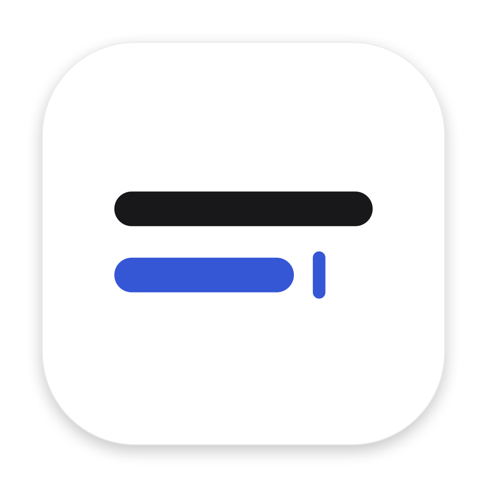
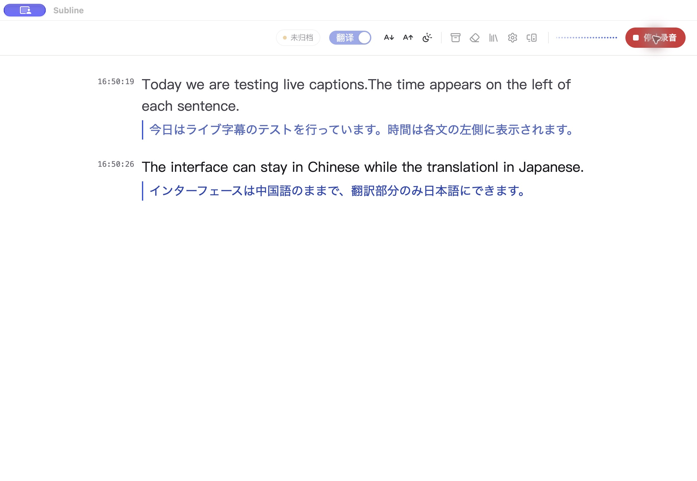
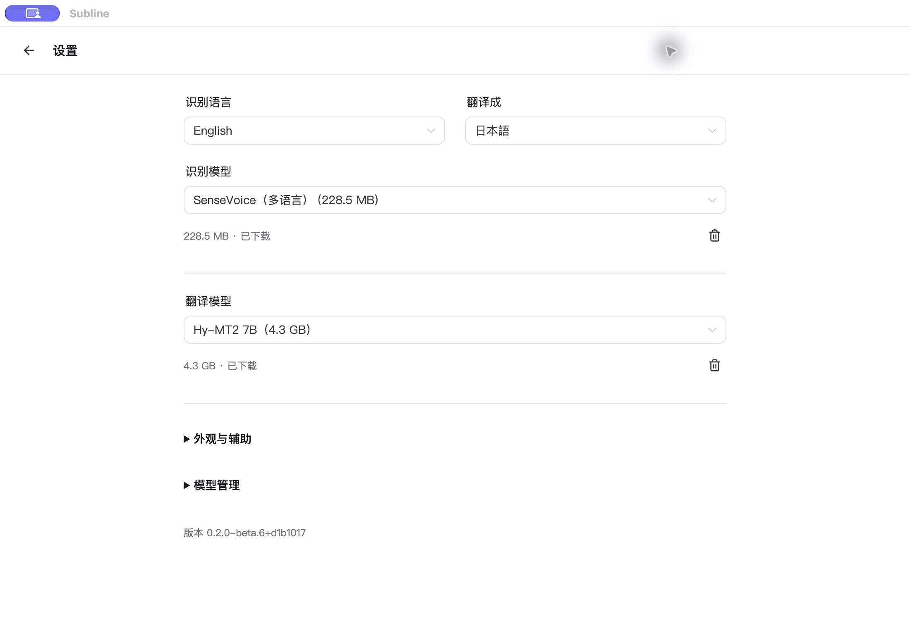
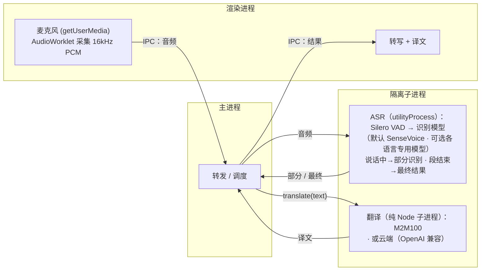

<p align="center"></p>

# Subline

本地实时转写与翻译，把原文和译文放在连续的双语字幕流中。

**[English / 构建与验证说明](README.md)** · [产品规则](docs/product/experience.md) · [代码地图](docs/project-map.md)

基于 [baijunjie/realtime-translator](https://github.com/baijunjie/realtime-translator)，由 [Jack](https://github.com/sany2ng0226-boop) 维护，保留上游作者署名、元数据及 Git 历史。当前定制集中在日中双语阅读、本地翻译与记录整理。



*本机已安装的 beta.6 验收构建：实际采集英语合成测试语音的系统音频，并由识别与翻译模型生成字幕。输出未经改写，不作为性能测量。Beta.6 尚未发布，下方公开下载仍为 beta.5。*

<details>
<summary>设置：识别语言与翻译目标独立选择</summary>



*同一本机 beta.6 构建；识别模型与翻译模型直接显示在设置首页。*

</details>

## 当前源码节点

- SenseVoice 本地识别 + 应用内 Hy-MT2 7B Q4_K_M Metal 翻译。模型下载后无需 LM Studio、API Key 或另启模型服务。
- 临时原文在原位续写与确认，译文回填对应行；上翻回看保持位置，点击“回到最新”恢复跟随。
- 日语使用规则合句与有限原文上下文；模型判断切句仍只用于离线实验。
- Internal 支持单层文件夹、内容提取标题、改名和移动，保存后重启保留。停止录音不会自动归档。
- Subline 与 Subline Internal 的设置、模型和归档分离，改名后沿用各自数据目录。

## 验证与发布边界

**[下载 Subline 0.2.0-beta.5](https://github.com/sany2ng0226-boop/subline/releases/tag/v0.2.0-beta.5)**，适用于 Apple 芯片 Mac、macOS 14.2 或更新版本。已作为预发布版（prerelease）公开。**Subline.app 与 DMG 均已 Developer ID 签名、分别通过 Apple 公证并附上票据**；DMG 与包内应用均通过票据和 Gatekeeper 检查。公开链接无需登录即可下载，重新下载的文件 SHA-256 一致，产物复验通过。

公开渠道安装的是 **Subline.app**，提供连续字幕与手动归档；文件夹归档和主页语言选择只在独立的 **Subline Internal** 中提供。

1. 下载 arm64 `.dmg`，将 **Subline.app** 拖入“应用程序”，正常打开并选择母语。公开包采用 Developer ID 签名和 Apple 公证；每次新包发布前分别检查签名、公证票据与 Gatekeeper 放行结果。
2. 新安装默认只转写。在设置中选择日语识别，开始录音并确认识别模型下载。需要翻译时，再在设置中启用本地翻译并下载 Hy-MT2 7B，约 **4.3 GiB / 4.62 GB**，连同识别模型合计约 **4.5 GiB**。需联网并预留额外空间；Hy-MT2 下载会核验固定文件的大小和 SHA-256。
3. 下载后在本机识别与翻译，**不需要 LM Studio、API Key 或另启模型服务**。按提示允许麦克风或系统音频录制。首次翻译需等待模型加载。
4. 停止录音后，等译文完成，点击顶栏归档入口并保存；停止不会自动保存。

修复版本已完成短时录音、退出和崩溃恢复检查，并验证在其他应用前台时用 **⌥⌘R** 开始和停止录音。修复候选已实测日语系统音频原文与中文译文；本机 beta.5 更新后已恢复字幕。长时间持续录音尚未验证。

此前已用空白用户数据目录完成引导和真实模型下载，并在 48 GB 内存的 Apple 芯片开发机测试系统音频转写与本地翻译。真人麦克风识别、远距离、多人噪声、整场活动、长时开发负载及其他内存容量尚未验收。识别仍可能出错。此次不代表 iOS / Web 已通过运行验收。

旧 `v0.2.0-beta.1` 是 Classroom Translator 历史测试包，`v0.2.0-beta.2` 是历史 Subline Internal 测试包；下方上游下载不属于 Subline。Internal 与公开渠道使用各自的设置、归档和模型目录；替换 Subline.app 会沿用公开渠道的现有数据。

## Windows 候选版

Windows 版目标为 **Windows 10/11 x64**：录音前选择麦克风或默认播放设备的系统声音，使用本地 SenseVoice 识别、Hy-MT2 7B 翻译，并手动保存文字归档。候选版本为 **0.2.0-beta.3-windows.1**，目前尚未公开发布或完成真实设备验收；Mac 发布版见上文，其验收不代表 Windows 候选已通过。

本地翻译优先尝试随包提供的 NVIDIA CUDA 运行时，不可用时明确显示 CPU 降级；不会自动切到云服务。具体显卡、显存和内存未知，尚无经过验收的最低硬件配置，也不承诺 CPU 实时速度。首次模型下载需联网和用户确认。

候选版的设置、归档与模型独立保存在 `%APPDATA%\Subline Windows Candidate`。安装器未签名，Windows SmartScreen 可能提示未知应用；核对来源与校验值，不要全局关闭系统防护。常规卸载保留应用数据。本轮不包含 Meeting、面试辅助或影子跟读。

Windows x64 构建命令为 `pnpm --filter @rt/macos dist:win`，`apps/macos` 与包名沿用共享桌面宿主的历史名称；命令准备 NSIS 安装器和 ZIP，不发布。[Windows 工作流](https://github.com/sany2ng0226-boop/subline/actions/runs/39389617116) 已在 Windows Server 2022 上通过源码检查、未压缩应用构建、随包 CPU/原生绑定检查，以及合成界面、设置和归档页面重载与磁盘读回。NSIS 安装器、ZIP、SHA-256 清单及工作流产物已成功生成并上传；安装流程本身仍未验收。真实收音、系统回环、实际模型推理（含 CUDA）、完整应用重启、Windows 10 及朋友硬件仍未验收。详见 [Windows 范围与朋友验收清单](docs/product/windows-candidate.md)。

## 从源码运行

使用 Node.js 22 和 `package.json` 固定的 pnpm **10.33.0**：

```sh
git clone https://github.com/sany2ng0226-boop/subline.git
cd subline
npx pnpm@10.33.0 install --frozen-lockfile
npx pnpm@10.33.0 dev
# 构建带文件夹归档与主页语言选择的 Internal：
npx pnpm@10.33.0 --filter @rt/macos dist:preview
```

默认产物：`apps/macos/release-preview/mac-arm64/Subline Internal.app`。构建不安装、不发布；有可用签名身份和完整公证凭据时，electron-builder 会在签名后自动提交公证，无公证凭据则跳过提交。模型下载与麦克风／系统音频权限需在应用中确认。

## 数据与署名

识别在本机运行；本地翻译不向服务商发送会话文字。手动选择 API 翻译时，定稿文字及 macOS 有限原文上下文会发往指定端点，音频不上传。归档保存文字和已完成译文，不保存原始录音，也不会在保存后自动补入晚到译文；没有跨设备同步。

仓库不含私有课堂录音与转写、个人配置、凭据、下载的模型或本机构建产物。上游包清单声明 `ISC`，所核对源码中没有独立许可正文；本仓库保留原有声明，不替上游代码另行授权。进一步分发前请核对上游许可。模型与依赖各自遵循其条款。

---

## 上游文档

以下保留上游的平台与开发说明。**本页上方和 English README 描述 Subline 当前状态；下方的上游下载与演示链接不代表本次 Subline 产物。**

> **课堂定制版**：本仓库基于 [baijunjie/realtime-translator](https://github.com/baijunjie/realtime-translator)，保留上游历史。新增原位字幕流、日中原生字体与排版、规则合句、翻译上下文和 macOS 翻译队列控制。定制版配置与构建方法见[仓库主页](README.md)，当前行为以[产品规则](docs/product/experience.md)为准。以下下载链接指向上游版本，并非本定制版。课堂录音、个人设置、凭证和额外下载的模型权重不随源码上传。

<p align="center">
  
</p>

# Realtime Translator

> 本地实时语音转写与翻译，支持 macOS、iOS 与浏览器——音频和文本都留在本机（云端翻译为可选项）。

[English](README.md) · **简体中文** · [日本語](README.ja.md) · [한국어](README.ko.md)

无需安装，立即在浏览器里试用网页版：**https://baijunjie.github.io/realtime-translator/**

## 平台

三端共享同一套核心逻辑与界面，差别在于运行方式和少数能力：

|  | macOS | iOS | 网页 |
|---|---|---|---|
| **获取方式** | 未签名 `.dmg`（[Releases](https://github.com/baijunjie/realtime-translator/releases)） | 自行从源码构建 | [浏览器打开](https://baijunjie.github.io/realtime-translator/) / 安装为 PWA |
| **识别模型** | SenseVoice + Paraformer / ReazonSpeech / Parakeet | SenseVoice | SenseVoice + Paraformer / ReazonSpeech / Parakeet |
| **本地翻译** | M2M-100 418M / 1.2B | Apple 端上翻译 | M2M-100 418M † |
| **云端翻译** | ✓ | ✓ | ✓ |
| **音频来源** | 麦克风 + 系统音频（14.2+） | 麦克风 | 麦克风 |
| **运行时** | Electron · sherpa-onnx N-API | Capacitor · 原生 C++ | 浏览器 · 单线程 WASM |
| **存储** | 应用数据文件 | Preferences | IndexedDB + Cache |

† iOS / iPadOS Safari 上不支持本地翻译（WebKit 单标签页内存无法与 ASR 同时容纳翻译模型），这些设备仅提供云端翻译。

### macOS

下方上游链接属于 Realtime Translator。本次 Subline 请使用本页上方的下载与安装步骤，复制到“应用程序”后正常打开；标准首次打开和音频权限提示仍可能出现。

macOS 是功能最全的一端：除麦克风外还能采集**系统音频**（Mac 正在播放的声音，需 macOS 14.2+），并额外提供更高质量的 M2M-100 1.2B 翻译模型。

### iOS

暂无预构建的安装包，需自行从源码构建：原生插件要接入 Capacitor iOS 壳，依赖 Xcode 工具链和真机（Apple 的 Translation 框架无法在模拟器运行）。详见 [`apps/ios/native-plugin/INTEGRATION.md`](apps/ios/native-plugin/INTEGRATION.md)。识别在设备端运行（SenseVoice），翻译用 Apple 的端上 Translation 框架（iOS 18+）。

### 网页

完全在浏览器里运行——无需安装、无需服务器。**在 [baijunjie.github.io/realtime-translator](https://baijunjie.github.io/realtime-translator/) 直接打开**，或安装为 PWA；首次加载后即可离线使用（模型与应用外壳都会缓存）。仅支持麦克风。

## 功能

- 实时识别中文 / 日语 / 英语 / 韩语——可自动检测，或锁定为单一语言以显著减少短句的语种误判
- 实时字幕——说话过程中显示部分结果，语音段结束后定稿
- **母语驱动**——所选语言既是界面语言也是翻译目标；其他语言统一翻成它（中文归一化为简体）。自动检测模式下，母语会被反向翻成本次会话最近一次听到的其他语言
- **本地或云端翻译**——本地模型离线运行、文本不出机器；云端为可选的 OpenAI 兼容端点（文本会发往第三方）
- 识别与翻译模型均按需下载（不打进安装包）
- 对话归档——保存一次会话，之后可重新查看
- 纯 CPU 实时运行（Apple Silicon 实测 RTF ≈ 0.03），无需 GPU

## 使用

1. **首次启动**——在引导页选择你的母语。
2. 点击**开始录音**——字幕随说话实时出现。若所选识别模型尚未下载，会先确认下载，下载转入后台、模型就绪后自动开始录音（你可以只取消本次录音，让下载继续）。
3. 在设置里选择**翻译方式**（本地模型 / 云端 / 关闭）——每行下方显示母语译文。
4. 点 **⚙ 设置**——可改母语、识别语言与识别模型、音频来源、字体大小、主题、翻译方式（及云端凭证）；「模型管理」标签页可查看、下载或删除各模型。

请求麦克风或系统音频前，应用会先在应用内说明用途，随后系统才弹出授权提示；若曾被拒绝，可一键打开对应的系统设置页。

## 模型

所有模型都在按需时从 `@rt/core` 注册表获取（不随包分发）。获取来源按端分 + 有序兜底：**macOS / iOS** 优先自托管 GitHub Release（`models-v1` 资产），失败自动回退上游 HuggingFace；**网页**因 GitHub Release 资产不发 CORS 头，直接用上游 HuggingFace（可选镜像）。每个源只试一次，全部失败才判失败。

| 模型 | 用途 | 平台 | 大小 |
|---|---|---|---|
| Silero VAD | 语音端点检测（各识别模型共用） | 全平台 | 约 0.6MB |
| SenseVoice (int8) | 多语言识别（默认） | macOS / iOS / 网页 | 约 230MB |
| Paraformer-zh (int8) | 中文识别 | macOS / 网页 | 约 220MB |
| ReazonSpeech-ja | 日语识别 | macOS / 网页 | 约 160MB |
| Parakeet-en (int8) | 英语识别 | macOS / 网页 | 约 630MB |
| M2M100-418M (q8) | 多语言翻译（默认） | macOS / 网页 | 约 640MB |
| M2M100-1.2B (q8) | 多语言翻译（更高质量） | macOS | 约 1.5GB |

iOS **不**下载翻译模型，改用 Apple 的端上翻译。中文译文统一做简体归一化（M2M100 / Apple 都不区分简繁字形）。网页端 Silero VAD 随应用同源分发，不单独下载。

## 技术架构

一个 **pnpm workspace monorepo**：共享逻辑与界面，每个平台一个包。三端都渲染**同一套 `@rt/ui`**，差别只在注入的 `AppBridge`——界面通过它触达平台能力（采音、存储、识别、翻译）。

- `packages/core`（`@rt/core`）——平台无关 TS：领域类型、设置/归档逻辑、翻译（`Translator` 接口 + 云端 + 中文简体归一化）、ASR 与本地翻译的多模型注册表，以及 `AppBridge` 契约。
- `packages/ui`（`@rt/ui`）——共享 Vue 3 界面；仅通过注入的 `AppBridge` 触达平台（不直接用 `window.api`）。
- `apps/macos`（`@rt/macos`）——Electron 应用。
- `apps/ios`（`@rt/ios`）——Capacitor 应用 + 原生插件。
- `apps/web`（`@rt/web`）——浏览器 PWA。
- `assets/`——共享品牌源（`icon.svg` / `icon.png`），各平台由它生成自己的图标格式。

转写在各端都用 [sherpa-onnx](https://github.com/k2-fsa/sherpa-onnx)（ONNX Runtime），只是运行时按端不同（见上方[平台](#平台)对比表）。本地翻译在 macOS / 网页用 [Transformers.js](https://github.com/huggingface/transformers.js) 跑 Meta M2M100（MIT），iOS 用 Apple 的 Translation 框架。二者都封装在 `@rt/core` 的接口之后——换更强的本地模型或云 API，只是新增一个实现。

在 macOS 上，ASR 跑在独立的 Electron `utilityProcess`，翻译跑在独立的纯 Node 子进程（`child_process.fork` + `ELECTRON_RUN_AS_NODE`，脱离 Chromium 的内存分配器以支撑 1.5GB 级模型推理）：重推理不阻塞 UI，原生崩溃或超大内存分配也只影响该子进程。网页上对应的隔离是每个任务一个 Web Worker；iOS 上则由原生插件承担。



*（图为 macOS 的进程划分；iOS 与网页不同——分别是原生插件 / WASM Worker，不是 Electron 进程。）*

## 开发

需要 **pnpm**。Vite + Vue 3 + Naive UI，全 TypeScript（macOS 用 electron-vite）。

```bash
pnpm install
pnpm dev                    # 跑 macOS 应用（热更新，→ @rt/macos）
pnpm --filter @rt/web dev   # 跑浏览器 PWA 开发服务器（→ @rt/web）
```

iOS 见 [`apps/ios/native-plugin/INTEGRATION.md`](apps/ios/native-plugin/INTEGRATION.md)。其他脚本：`pnpm build`、`pnpm type-check`；单包 `pnpm --filter @rt/macos <script>`（如 `clean`、`test-translate`）。

**打包（macOS）**——`pnpm dist` 构建 arm64 `.dmg` 到 `apps/macos/release/`（`pnpm dist:dir` 只生成未压缩 `.app`，调试用）。签名取决于本机可用身份；electron-builder 25.1.8 可通过 `APPLE_KEYCHAIN_PROFILE` 等受支持的完整凭据自动公证。发布前仍须检查最终应用的签名、公证票据与 Gatekeeper 结果，详见[公证配置](docs/release/notarize.md)。

**网页部署**——GitHub Actions 工作流（`.github/workflows/ci.yml` 的 `deploy-web` job）在每次推送到 `main` 且质量门禁（`check`）全绿后部署到 GitHub Pages。ASR 特意用单线程 WASM，从而无需 COOP/COEP 头，可免费托管在 Pages。

**离线测试（无需 GUI）**：

```bash
npm run test-pipeline -- test.wav   # 转写，需 16kHz 单声道
# 转换: afconvert -f WAVE -d LEI16@16000 -c 1 in.wav out.wav
npm run test-translate              # 多向翻译（首次会下载模型）
```
