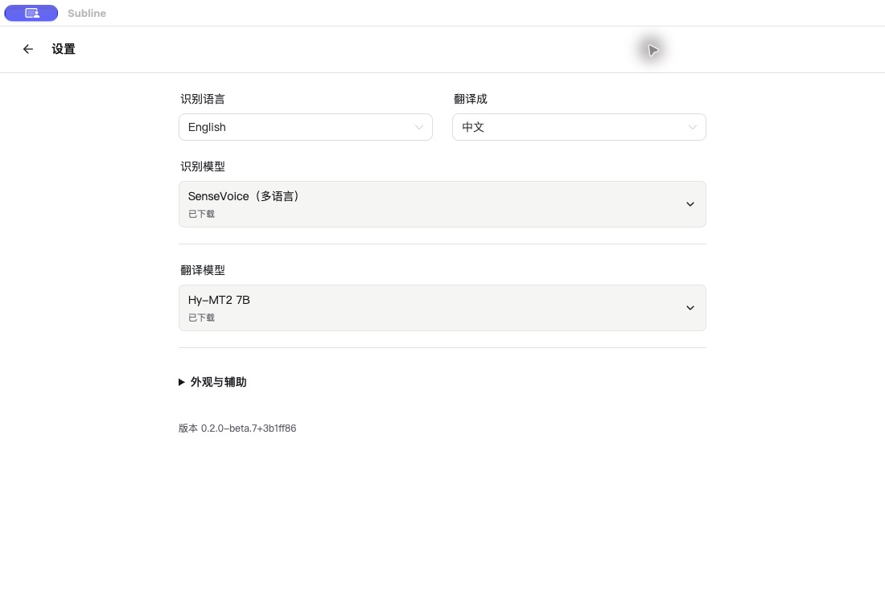
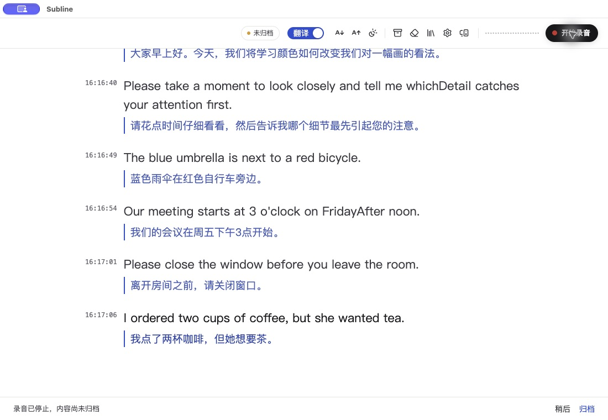

# Subline 零基础快速开始

普通用户直接下载安装包即可，**不需要注册 GitHub、克隆源码、安装 Git 或使用终端**。

## 先确认电脑是否支持

点击 Mac 左上角  →「关于本机」：

- 芯片：Apple M1 或更新型号。
- 系统：macOS 14.2 或更新版本。
- 目前没有面向普通用户的 Intel Mac、Windows 或 iPhone 公开安装包。
- 模型额外占用：只转写约 0.25 GB；M2M-100（轻量，418M） 翻译约 0.7 GB；Hy-MT2 翻译约 4.6 GB。安装、下载还需额外空余空间。
- 8 / 16 GB Mac 建议先试只转写，需要翻译时先试 M2M-100（轻量，418M）。本地翻译仅在 48 GB Mac 上验证过，其他内存容量的实际流畅程度尚未确认。

## 1. 下载并安装

**[点击下载 Subline Mac 安装包（beta.8）](https://github.com/sany2ng0226-boop/subline/releases/download/v0.2.0-beta.8/Subline-0.2.0-beta.8-arm64-notarized.dmg)**

下载完成后，双击 `.dmg` 文件，把 **Subline.app 拖进「应用程序」**，再从「应用程序」打开它。按系统提示确认首次打开即可；应用与安装包已签名并通过 Apple 公证。

不用点击绿色 Code 按钮，也不用下载 Source code。如果直链下载失败，可打开[版本下载页](https://github.com/sany2ng0226-boop/subline/releases/tag/v0.2.0-beta.8)，展开 Assets，选择以 `.dmg` 结尾的文件。当前安装包仍由 GitHub 提供，尚无国内备用下载。

## 2. 设置识别语言和翻译

首次打开按提示选择界面语言，然后进入设置：

1. 把「识别语言」设为实际听到的语言，例如日语。
2. macOS 26+ 可选择 Apple 语音识别；其他支持的系统可用 SenseVoice，按提示下载识别模型。确认已选中准备使用的模型。
3. 新安装默认只转写。需要中文译文时，选择本地翻译模型，把「翻译目标」设为中文。8 / 16 GB Mac 建议先试 M2M-100（轻量，418M）。模型下载完成后，再选中它。

上图为 beta.7 实际界面；当前下载为 beta.8，增加了 Apple 语音识别等选项，界面可能略有不同。

首次下载需要联网。所需资源准备完成后，本地识别与本地翻译可以离线使用，不需要 API Key 或另开模型服务。

## 3. 选声音来源并开始

| 你想听什么 | 选择 |
| --- | --- |
| 教室里、身边的人说话 | 麦克风 |
| Mac 正在播放的网课、视频、会议声音 | 系统音频 |

按提示允许对应音频权限，点击开始录音。第一次使用要等待模型加载，先试一小段，确认原文出现，需要翻译时再确认译文出现。

上图为 beta.7 使用合成英语语音的实际截图，不能作为识别准确度承诺；识别与翻译都可能出错。

## 4. 结束后归档保存

停止录音 → 等译文完成 → 点击顶栏归档入口 → 保存。保存后从归档页查看；beta.8 可回放原音。

**停止录音不会自动保存。未归档录音会在退出时清理。**

## 常见问题

- **下载慢或没有反应：** 尝试在电脑的 Safari 或 Chrome 打开下载链接。目前仍通过 GitHub 下载，网络可达性和速度因地区而异。
- **只有原文：** 检查翻译是否开启、翻译目标是否为中文、模型是否下载完成并选中。
- **没有字幕：** 检查声音来源、模型状态和「系统设置 → 隐私与安全性」里的对应音频权限，按系统提示重新打开应用。
- **打不开或提示损坏：** 确认电脑符合要求，重新从本页下载原始 DMG。仍失败时记录具体提示，无需关闭系统安全保护。
- **需要帮助：** [邮件反馈](mailto:sany2ng0226@gmail.com?subject=Subline%20%E4%BD%BF%E7%94%A8%E5%8F%8D%E9%A6%88)或 [GitHub Issues](https://github.com/sany2ng0226-boop/subline/issues)。附电脑芯片、系统版本与报错截图，分享前遮住私人内容。
